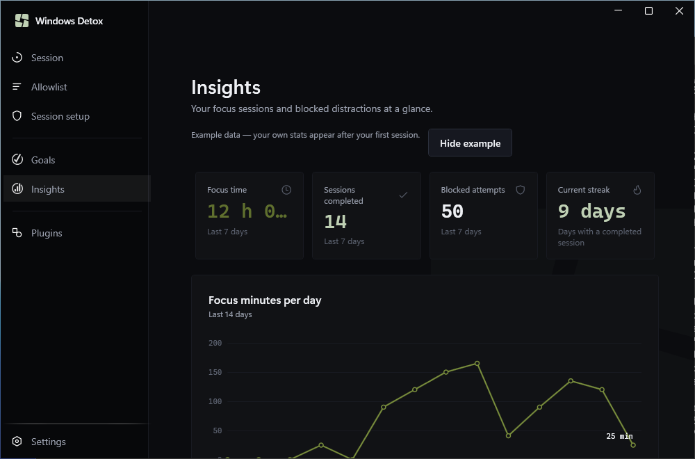

# Plugin pages and settings sections

Blocks live in `src/Blocker.UI.SDK/UiNodes.cs`, factories in `Ui.cs`, limits in `UiTreeValidator.cs`. Copy `plugins/FocusInsights` (charts, example state) and `plugins/GoalsTasks` (forms, toggles, buttons).

## Standard page layout

Every plugin page uses the same structure as the Insights page, so all pages look like one product:



Order, top to bottom (each part optional except the header and the first content block):

1. **Header** - the official `UiPage` title and subtitle, drawn by the host. Nothing else repeats it.
2. **Note / action row** (optional) - one `Ui.Row(Ui.Text(..., UiTextStyle.Caption), Ui.Button(...))`, e.g. "Example data - your own stats appear after your first session." with "Hide example".
3. **Stat tile grid** - `Ui.Grid(n, Ui.Stat(...), ...)` as a direct child of the page, with 2 to 4 tiles (4 on wide pages like Insights). Never put tiles inside a card.
4. **Chart cards** - `UiCard` with a title (noun phrase), a one-line subtitle (scope, e.g. "Last 7 days") and exactly one chart. Two small cards may share `Ui.Grid(2, ...)`.
5. **Lists, forms, tables** - one card each: the add form, the list and its buttons stay together in one card; a `UiTable` gets its own card.

Tile rules:

- Label: at most 2 words ("Done this week", "Open tasks"). Icon always set (`UiIcon`), tone says the mood (Accent, Success, Neutral).
- Value: short, at most 6 characters, so the big monospace text never truncates. Insights once showed "13 h 5..." for "13 h 05 min": format compactly ("13.1 h", "45 min", "1 h", "3 / 5", "7+") and put the unit or detail in the caption.
- Caption: one short line ("Last 7 days", "Days in a row", "2 to go").

Card rules: title + one-line subtitle (or no subtitle when it adds nothing), one chart per card, a lone chart gets a card (pass a null chart title because the card has it). A list with its form and actions is a single card. Small secondary actions (e.g. "Goal -1" / "Goal +1", "Clear completed") go at the end of that card or in its list row, as `UiButtonVariant.Subtle` or `Secondary`; at most one `Primary` per page.

Empty and example state: when there is no data, show one card with a calm explanation and a "Show example" button; the example uses the same layout function and starts with the note row at the top (see below). Data-driven cards always have a caption empty state.

Do not: add a hero, logo or `UiGlyph`; repeat the page title in the content; nest cards; place free-floating stat tiles inside other cards (tiles live only in the grid under the header); use more than 4 tiles per grid; write long sentences in tiles; stack several charts in one card.

Minimal skeleton (real API, one pure function builds the body so real and example data share it):

```csharp
public ValueTask<UiPage> RenderAsync(UiRenderContext context, CancellationToken cancellationToken) =>
    ValueTask.FromResult(Ui.Page(
        "Goals & Tasks",                                   // Navigation title or the noun the plugin manages
        "Pick a few focus tasks for today and tick them off.",
        Ui.Grid(
            4,
            Ui.Stat("Today", "2 / 3", "1 to go", UiTone.Accent, UiIcon.Target),
            Ui.Stat("Done this week", "9", "Last 7 days", UiTone.Success, UiIcon.Checkmark),
            Ui.Stat("Streak", "4", "Days in a row", UiTone.Success, UiIcon.Flame),
            Ui.Stat("Open tasks", "1", "Today", UiTone.Neutral, UiIcon.Clock)),
        new UiCard(
            [
                Ui.Form("goals-add", "Add", new UiTextField("goals-add-text", "New task", string.Empty, "What will you focus on?", 120)),
                Ui.Toggle("goals-done-1", "Write report", false),
                Ui.Button("goals-clear", "Clear completed", UiButtonVariant.Secondary, UiIcon.Checkmark),
            ],
            "Today's tasks",
            "1 open, 2 done"),
        new UiCard(
            [new UiBarChart([Ui.Point("Mon", 2), Ui.Point("Today", 3)], null, "done")],
            "Completed per day",
            "Last 7 days")));
```

## Page (`IUiPagePlugin`, `ui.page`)

- `UiNavigationItem Navigation { get; }` = `new("Goals", UiIcon.Target)`: title 1-32 printable chars, defined `UiIcon` (sidebar shows the manifest `icon` instead when present; the title is still the label and must be unique among sidebar items).
- `RenderAsync` returns `Ui.Page(title, subtitle, children...)` (`UiPage`, only valid as root). The HOST renders the official page title and subtitle as the page header: never repeat the title, the plugin name, a logo (`UiGlyph`) or a "welcome" heading in the content. Title = plugin name or the noun it manages; subtitle = one calm sentence saying what the page is for.
- Content follows "Standard page layout" above; a page should be scannable in five seconds. Order: headline numbers, main visual, details, history.
- Card: `new UiCard(children, title, subtitle, icon)` or `Ui.Card(title, children...)`. Title = noun phrase ("Today's tasks"), subtitle = scope ("Last 7 days"). Never nest cards. Wrap a lone visual in a card with a title instead of leaving it bare.
- Stat tiles: `Ui.Stat(label, value, caption, tone, icon)` inside `Ui.Grid(2..4, ...)` (Insights uses 4); value is pre-formatted and at most 6 characters ("13.1 h", never "13 h 05 min"). Grid columns 1-6.
- Prefer `Ui.Row`/`Ui.Column` (`UiGap` Small/Medium/Large) for grouping; max depth 16.

## Charts and tables (all values finite; texts 1-2000 chars)

| Block | Use | Validator limits |
|---|---|---|
| `Ui.BarChart(title, points)` / `new UiBarChart(points, title, valueSuffix)` | a few categories, last 7 days | <= 500 points, aim 7-12; non-empty labels |
| `UiLineChart(series, title, suffix)` | trend over time | 1-6 series, each <= 500 points, x order |
| `Ui.DonutChart(title, slices)` / `UiDonutChart(slices, title, centerValue, centerLabel)` | share of a whole | 1-6 slices, values >= 0 |
| `UiHeatmap(rowLabels, colLabels, values, title, suffix)` | weekday x hour | rows 1-12, columns 1-24, `Values[row][col]` finite and >= 0, exact dimensions |
| `UiTable(columns, rows)` with `UiTableColumn(header, alignment, monospace)` / `UiTableRow(cells)` | short fact lists | 1-12 columns, <= 500 rows, one cell per column; right-align and `Monospace` numbers |
| `UiProgress(value, max, label, tone)` | amount done | max > 0, 0 <= value <= max |

Pass a null chart title when the surrounding card already has one (Insights does). All counts count toward the 2000-node tree budget (points, rows, fields count as nodes) and 512 KiB serialized size. Keep charts to what the user needs; cap loops (`Take(n)`). No `UiGlyph` with a chart title as decoration.

## Forms, inputs, actions

- `Ui.Button(id, label, variant, icon)` (`UiButtonVariant`: Primary at most one per view, Secondary, Warning, Subtle; `IsEnabled` via record ctor: disable at limits like `goal > MinGoal`), `Ui.Toggle(id, label, isOn, description)` (receives `UiAction.Toggle`, `Value` "true"/"false"; persist yourself), `Ui.Form(id, submitLabel, fields...)` with `UiTextField(id, label, value, placeholder, maxLength<=2000)`, `UiNumberField(id, label, value, min, max, step)` (min <= value <= max, step > 0), `UiSelectField(id, label, options, selectedValue)` (`UiOption(value, label)`, selected must exist), `UiCheckboxField`. Submit arrives as `UiAction.Submit` with string `FormValues` keyed by field id.
- Ids: `^[A-Za-z][A-Za-z0-9_-]{0,63}$`, unique in the whole tree (buttons, toggles, forms and fields share one namespace); use slug prefix + hyphens, no dots: `goals-add`, `goals-add-text`, `goals-del-12`.
- In `OnActionAsync`: check `action.Kind` first, then the id (exact constants or prefix + `int.TryParse`), then validate and clean values (trim, strip control chars, clamp length/range, enforce max items); ignore anything unexpected, never throw for user input. After a change, persist, raise `Changed`, `RequestRender()`.
- Copy: buttons are verbs ("Add", "Clear completed"), labels are nouns, sentence case, no exclamation marks or shaming, plural-correct counts. Plain text only; no control characters.

## Empty and example states

- Every data-driven card needs an empty state: a caption (`Ui.Text(text, UiTextStyle.Caption)`) saying what will appear and when ("Completed tasks show up here."), not an empty chart.
- For event-driven data (nothing to see before the first session) offer an example like Insights: empty page shows a card with explanation + `Ui.Button(ExampleButtonId, "Show example", UiButtonVariant.Secondary)`; the preview adds a caption row ("Example data — your own stats appear after your first session.") with a "Hide example" button, and renders the same layout function with generated sample data. Keep the flag in memory (`Volatile`), never write sample data to storage, cache the generated example per day/zone.
- Share one pure layout function between real and example data so they cannot drift.

## Settings section (`ISettingsSectionPlugin`, `ui.settings`)

- `string Title { get; }` (section heading, drawn by the host) and `RenderAsync` returning any `UiNode` (existing sections return `Ui.Column(...)`; not a `UiPage`, no heading text repeated).
- Pattern: a short explanation (`Caption`), the controls (toggles with descriptions, +/- buttons or a small form), then dangerous actions last. Keep to decisions the user must make.
- Destructive actions (clear data, reset) need a second click, as in `InsightsSettings` and `GoalsSettings`: first click arms (store `Time.GetTimestamp()` and a flag with `Volatile`, `RequestRender()`), the button then reads "Click again to confirm" with `UiButtonVariant.Warning` and `UiIcon.Warning`; a second click within the window (`ConfirmWindow` = 10 s, checked with `Time.GetElapsedTime`) performs the action; after the window the button reverts. If the action changes nothing, still `RequestRender()` so the button leaves the armed state. Describe what will be deleted in a caption above.
- Privacy-relevant recording options (e.g. storing app names) are off or clearly described toggles.

## Validity and tests

`ctx.RenderAsync(...)` throws `UiValidationException` (and checks the JSON round trip) when a tree breaks any limit; render page, settings and the example/empty variants in tests, assert the headline text/values exactly, assert no `UiGlyph` and that the page tree has no repeated title, test both clicks of every confirm button (use `ctx.FakeTime.Advance` past the window), invalid form input, and storage content after actions.

## Checklist

- [ ] `Ui.Page(title, subtitle, cards)`; nothing repeats title/logo in content; nav title <= 32.
- [ ] Standard page layout: header, optional note row, 2-4 stat tiles (label <= 2 words, value <= 6 chars), chart cards, list/form card; no nesting.
- [ ] Cards with noun titles, no nesting; stats in a grid; charts within limits.
- [ ] Empty state for each card; example mode when data is event-driven.
- [ ] Ids unique, hyphenated, no dots; inputs validated; one Primary button max.
- [ ] Destructive settings need a second click; tests cover both clicks and the timeout.
